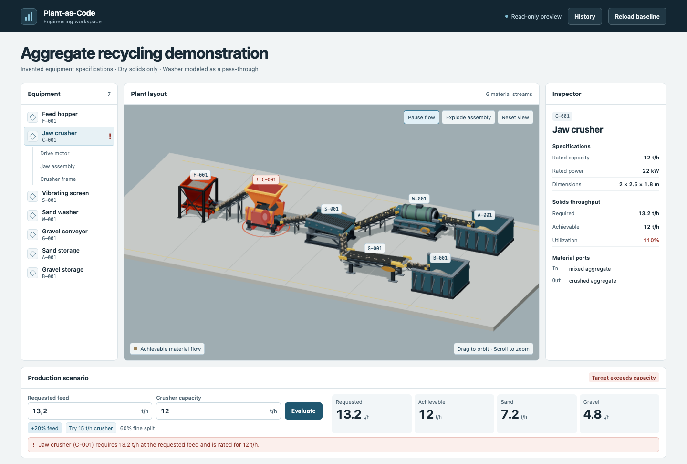

# Plant-as-Code

**A 3D workspace for designing, testing, and versioning industrial plant layouts.**

Plant-as-Code models a small aggregate recycling line. You can inspect equipment in 3D, change the production target, and see which machine limits output. The same YAML files drive the layout and the throughput calculations, so each design can be reviewed in Git down to the field that changed.

**[Open the live demo](https://plant-as-code-demo.mayasjain646.workers.dev/)** · [View published Git history](https://plant-as-code-demo.mayasjain646.workers.dev/#plant-history) · [Run locally](#run-locally)



*The crusher is highlighted because the requested 13.2 t/h exceeds its 12 t/h rating.*

## Try the demo

1. Select the **Jaw crusher** in the equipment list or 3D scene. Choose **Explode assembly** to inspect the motor, jaw, and frame.
2. Select **+20% feed**. Raising the target from **11 to 13.2 t/h** pushes the crusher to **110% required utilization**. The line can deliver **12 t/h**.
3. Select **Try 15 t/h crusher**. The plant can now meet the target. The material animation follows the achievable flow, and **Pause flow** freezes it for inspection.
4. Open **History** and select **Demo crusher upgrade** to compare the rehearsal commit with the published baseline. Choose **Reload baseline** to reset the public preview.

| Scenario | Requested feed | Achievable feed | Sand | Gravel |
| --- | ---: | ---: | ---: | ---: |
| Original design | 11 t/h | 11 t/h | 6.60 t/h | 4.40 t/h |
| Higher target, original crusher | 13.2 t/h | 12 t/h | 7.20 t/h | 4.80 t/h |
| Higher target, 15 t/h crusher | 13.2 t/h | 13.2 t/h | 7.92 t/h | 5.28 t/h |

The public site supports scenario previews and displays three real Git commits from the rehearsal. Use the local workspace to save YAML, create commits, and restore designs.

## How it works

The hopper feeds a jaw crusher, and a vibrating screen splits its output. The fine fraction passes through a sand washer to sand storage. The coarse fraction travels by conveyor to gravel storage.

- **Plant definition.** YAML holds equipment IDs, dimensions, rated capacities, typed material ports, and stream connections. The sample uses seven pieces of equipment and six material streams.
- **Throughput calculation.** The Python engine checks how much feed each machine and branch can handle. It reports required and achievable flow, equipment utilization, and mass balance. The browser and command-line tools use the same engine.
- **3D workspace.** React and Three.js render industrial GLB assemblies at their YAML dimensions. The scene shows connected conveyors, steel supports, and flow markers. The inspector links each selectable model or component back to its definition.
- **Version history.** The local FastAPI service reads and writes the plant files in a separate Git repository under `demo-plant/`. History shows field-level comparisons. Restoring a snapshot writes a new commit and preserves the earlier versions.

The sample uses invented equipment ratings, steady-state dry-solids flow, a pass-through washer, and a **60% fine fraction**. Storage acts as an output sink. The 3D layout and animation illustrate the engineering model. They do not establish belt speeds, collision clearances, energy consumption, or fabrication dimensions.

## Run locally

You’ll need **Python 3.11+**, **Git 2.28+**, **Node.js 22.12+**, and a **WebGL 2** browser. These commands are for macOS or Linux.

**Terminal 1** · Set up the demo plant and run the API from the repository root.

```sh
python3 -m venv .venv
source .venv/bin/activate
python -m pip install -r requirements.txt
python -m app.backend init
python -m uvicorn app.backend.api:app --host 127.0.0.1 --port 8000
```

**Terminal 2** · Start the browser workspace from the repository root.

```sh
cd app/frontend
npm ci
npm run dev
```

Open [http://127.0.0.1:5173](http://127.0.0.1:5173). Initialization copies the sample YAML and seeds its Git history. You can rerun it without losing existing plant work.

### Save, commit, and reset

1. Edit the feed and fine fraction under **Production scenario**. For equipment changes, select a machine and open **Edit specifications and geometry**.
2. Select **Evaluate** to preview the draft and **Save** to write it to YAML. If the files changed on disk, the app keeps the draft open and asks you to reload before saving again. If a save is interrupted, the next load rolls back partial writes.
3. Open **History**, compare the current commit with **Saved YAML**, enter a message, and choose **Commit saved changes**.
4. To repeat the demo, select **Seed aggregate recycling baseline** and choose **Restore snapshot**. The workspace returns to the original design after creating a restore commit. Resolve staged or uncommitted files and save or discard any draft before restoring.

## Project files

| Path | Contents |
| --- | --- |
| [app/baseline/](app/baseline/) | Sample plant definitions, components, streams, and requirements |
| [app/backend/](app/backend/) | Validation, throughput engine, command-line tools, and local Git API |
| [app/frontend/](app/frontend/) | 3D workspace, inspector, scenario controls, and history panel |
| [tests/](tests/) | Plant validation, throughput, API, and Git workflow tests |

For manual YAML edits, keep equipment and component IDs stable and update any affected stream endpoints. Run `python -m app.backend validate` to check the design, then choose **Reload** in the workspace. Model provenance, asset generation, and browser performance measurements are in [Industrial asset authoring](app/frontend/tools/README.md).

<details>
<summary>CLI checks and tests</summary>

From the repository root with the Python environment active:

```sh
python -m app.backend evaluate --plant app/baseline --feed 13.2
python -m app.backend evaluate --plant app/baseline --feed 13.2 --crusher-capacity 15

python -m pip install -r requirements-dev.txt
python -m pytest
npm --prefix app/frontend run build
node --experimental-strip-types --test app/frontend/tools/visual-factory.test.mjs
```

</details>

<details>
<summary>Cloudflare deployment</summary>

With the Python environment active, frontend dependencies installed, and `uv` and an authenticated Wrangler session available:

```sh
npm --prefix app/frontend run build
stage_dir="$(mktemp -d)/worker"
python -m deploy.cloudflare.stage "$stage_dir"
(cd "$stage_dir" && uv run --python 3.14 pywrangler deploy)
```

To include **History**, pass `--history-repo /path/to/rehearsal-plant` to the staging command. Use a dedicated rehearsal repository with a clean working tree and the sample baseline restored. The deployed demo then shows commit hashes, messages, dates, and field comparisons from that repository.

</details>
