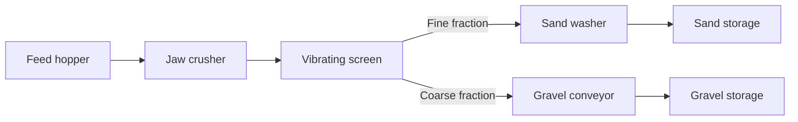

# Plant-as-Code

Plant-as-Code represents a miniature aggregate recycling plant as versioned YAML. The current milestone provides a sample plant, command-line validation and throughput evaluation, and a separate local Git repository for editing the design. The 3D workspace is planned.

The sample design starts at **11 t/h requested feed** with a **60% fine fraction**. Equipment ratings are invented for the demonstration. The process models dry solids, treats the washer as a pass-through, and uses storage as an output sink.

## Quick start

Install Python 3.11 or newer and Git 2.28 or newer. From the repository root, run these commands on macOS or Linux.

```sh
python3 -m venv .venv
source .venv/bin/activate
python -m pip install -r requirements.txt
python -m app.backend init
python -m app.backend validate
git -C demo-plant log --oneline
```

Validation lists seven equipment items, six material streams, and the crusher’s motor, jaw, and frame. Setup copies the sample YAML into `demo-plant/` and creates an initial commit in that directory’s own Git repository. Rerunning setup preserves local edits. Use `--plant PATH` to work with another local plant directory.

## Evaluate the crusher upgrade

Run both previews against the same baseline fixture. The requested feed stays at 13.2 t/h and the fine fraction stays at 60%. The upgrade changes only the crusher rating. Both previews are read-only.

```sh
python -m app.backend evaluate --plant app/baseline --feed 13.2
python -m app.backend evaluate --plant app/baseline --feed 13.2 --crusher-capacity 15
```

| Observed result | Original crusher | Upgraded crusher |
| --- | ---: | ---: |
| Crusher rating | 12 t/h | 15 t/h |
| Required crusher utilization | 110% | 88% |
| Achievable feed | 12 t/h | 13.2 t/h |
| Sand output | 7.2 t/h | 7.92 t/h |
| Gravel output | 4.8 t/h | 5.28 t/h |
| Mass balance residual | 0 t/h | 0 t/h |

The upgrade meets the target with no overload. At higher feed rates, the washer becomes the first constraint at about 13.33 t/h. Run `python -m app.backend evaluate` to evaluate the current YAML in `demo-plant/`. The CLI reports overloads as findings within a completed evaluation.

## Sample plant



The validator checks equipment and component references, port direction and material compatibility, specification bounds, and the process layout shown above. Scene coordinates use meters with Y up. Component positions are relative to their parent equipment.

## Repository layout

| Path | Contents |
| --- | --- |
| [`app/baseline/`](app/baseline/) | Sample YAML for equipment, components, streams, and requirements |
| [`app/backend/`](app/backend/) | Python models, YAML loader, throughput engine, and command-line interface |
| [`tests/`](tests/) | Validation, local Git setup, and throughput tests |

## Tests

```sh
python -m pip install -r requirements-dev.txt
python -m pytest
```
