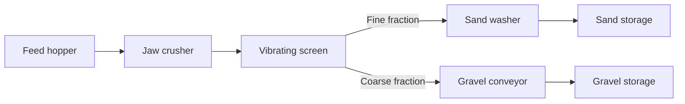

# Plant-as-Code

Plant-as-Code represents a miniature aggregate recycling plant as versioned YAML. The local 3D workspace lets you inspect equipment, evaluate throughput scenarios, and save designs to YAML. The command-line tools validate the plant, evaluate throughput, and initialize a separate Git repository for the design.

The sample design starts at **11 t/h requested feed** with a **60% fine fraction**. Equipment ratings are invented for the demonstration. The process models dry solids, treats the washer as a pass-through, and uses storage as an output sink.

## Quick start

Install Python 3.11 or newer and Git 2.28 or newer. From the repository root, run these commands on macOS or Linux.

```sh
python3 -m venv .venv
source .venv/bin/activate
python -m pip install -r requirements.txt
python -m app.backend init
python -m app.backend validate
git -C demo-plant log --oneline
```

Validation lists seven equipment items, six material streams, and the crusher’s motor, jaw, and frame. Setup copies the sample YAML into `demo-plant/` and creates an initial commit in that directory’s own Git repository. Rerunning setup preserves local edits. Use `--plant PATH` to work with another local plant directory.

## Open the 3D workspace

Install Node.js 22.12 or newer and use a browser with WebGL 2. Complete the quick start first, then run the API from the project root with the Python environment active.

```sh
python -m uvicorn app.backend.api:app --host 127.0.0.1 --port 8000
```

In a second terminal, from the project root:

```sh
cd app/frontend
npm ci
npm run dev
```

Open [the local workspace](http://127.0.0.1:5173). Select the jaw crusher in the layout or equipment list, then choose its motor, jaw, or frame to inspect that part. Select **+20% feed** to see the crusher overload, then **Try 15 t/h crusher** to evaluate the upgrade. Scenario previews run in memory.

### Edit, save, and reload locally

- Edit the requested feed and fine fraction in **Production scenario**. To change an equipment rating, power, or geometry, select the equipment and open **Edit specifications and geometry** in the inspector.
- **Evaluate** previews the entire draft. **Save** validates and writes the draft to YAML. A capacity shortfall stays visible as an engineering finding and can be saved for comparison. After saving, **Saved to YAML · Git changes** indicates work awaiting a commit.
- **Reload** reads the current YAML from disk. If a file changed externally, the save is rejected and your draft stays open. Copy any values you want to keep before confirming a reload. If YAML is malformed, the workspace names the affected file and keeps the last loaded design visible.

The saver checks a revision derived from the plant YAML and updates only changed files. Changed YAML files are reserialized. If a save is interrupted, the next local load uses a recovery journal to roll back its partial writes.

## Deploy the demo to Cloudflare

The Cloudflare Worker serves a preview-only workspace and runs the same Python simulation engine against the bundled sample plant. It uses the checked-in fixture in `app/baseline/` for every request.

From the project root, with the Python environment active, frontend dependencies installed, and `uv` and an authenticated Wrangler session available:

```sh
npm --prefix app/frontend run build
stage_dir="$(mktemp -d)/worker"
python -m deploy.cloudflare.stage "$stage_dir"
(cd "$stage_dir" && uv run --python 3.14 pywrangler deploy)
```

## Evaluate the crusher upgrade

Run both previews against the same baseline fixture. The requested feed stays at 13.2 t/h and the fine fraction stays at 60%. The upgrade changes only the crusher rating. Both previews are read-only.

```sh
python -m app.backend evaluate --plant app/baseline --feed 13.2
python -m app.backend evaluate --plant app/baseline --feed 13.2 --crusher-capacity 15
```

| Observed result | Original crusher | Upgraded crusher |
| --- | ---: | ---: |
| Crusher rating | 12 t/h | 15 t/h |
| Required crusher utilization | 110% | 88% |
| Achievable feed | 12 t/h | 13.2 t/h |
| Sand output | 7.2 t/h | 7.92 t/h |
| Gravel output | 4.8 t/h | 5.28 t/h |
| Mass balance residual | 0 t/h | 0 t/h |

The upgrade meets the target with no overload. At higher feed rates, the washer becomes the first constraint at about 13.33 t/h. Run `python -m app.backend evaluate` to evaluate the current YAML in `demo-plant/`. The CLI reports overloads as findings within a completed evaluation.

## Sample plant



The validator checks equipment and component references, port direction and material compatibility, specification bounds, and the process layout shown above. Scene coordinates use meters with Y up. Component positions are relative to their parent equipment.

## Repository layout

| Path | Contents |
| --- | --- |
| [`app/baseline/`](app/baseline/) | Sample YAML for equipment, components, streams, and requirements |
| [`app/backend/`](app/backend/) | Python models, YAML loader, throughput engine, and command-line interface |
| [`app/frontend/`](app/frontend/) | React and Three.js workspace |
| [`tests/`](tests/) | Validation, local Git setup, throughput, and API tests |

## Tests

```sh
python -m pip install -r requirements-dev.txt
python -m pytest
```

Run `npm run build` in `app/frontend/` to type-check and build the workspace.
