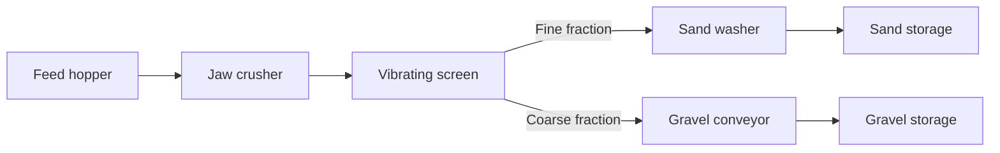

# Plant-as-Code

Plant-as-Code represents a miniature aggregate recycling plant as versioned YAML. The current milestone provides a sample plant, a command-line validator, and a separate local Git repository for editing the design. Throughput simulation and a 3D workspace are planned milestones.

The sample design starts at **11 t/h requested feed** with a **60% fine fraction**. Equipment ratings are invented for the demonstration. The process models dry solids, treats the washer as a pass-through, and uses storage as an output sink.

## Quick start

Install Python 3.11 or newer and Git 2.28 or newer. From the repository root, run these commands on macOS or Linux.

```sh
python3 -m venv .venv
source .venv/bin/activate
python -m pip install -r requirements.txt
python -m app.backend init
python -m app.backend validate
git -C demo-plant log --oneline
```

Validation lists seven equipment items, six material streams, and the crusher’s motor, jaw, and frame. Setup copies the sample YAML into `demo-plant/` and creates an initial commit in that directory’s own Git repository. Rerunning setup preserves local edits. Use `--plant PATH` with either command to work with another local plant directory.

## Sample plant



The validator checks equipment and component references, port direction and material compatibility, specification bounds, and the process layout shown above. Scene coordinates use meters with Y up. Component positions are relative to their parent equipment.

## Repository layout

| Path | Contents |
| --- | --- |
| [`app/baseline/`](app/baseline/) | Sample YAML for equipment, components, streams, and requirements |
| [`app/backend/`](app/backend/) | Python models, YAML loader, and command-line interface |
| [`tests/`](tests/) | Validation and local Git setup tests |

## Tests

```sh
python -m pip install -r requirements-dev.txt
python -m pytest
```
